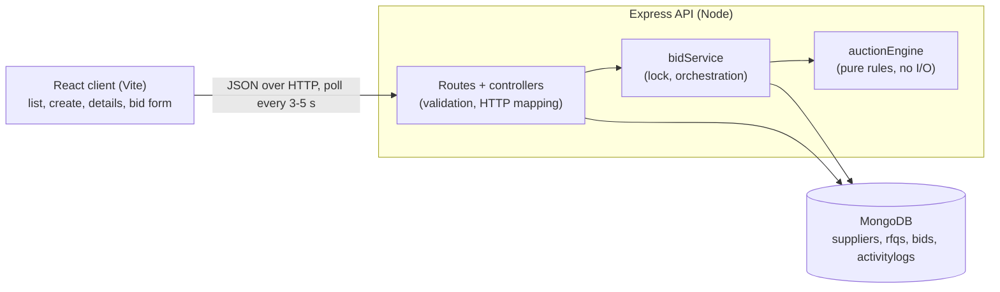
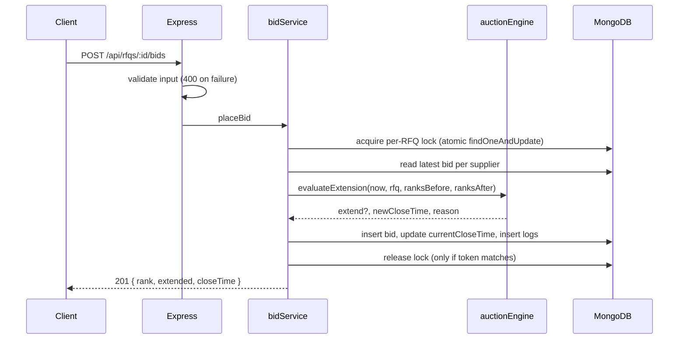

# High-Level Design: British Auction RFQ

## 1. Problem
A buyer creates an RFQ (request for freight quotes). Suppliers submit bids. In a
British auction the close time is not fixed: bids placed near the end can extend it,
up to a hard forced-close limit. The system must decide correctly, and consistently
under concurrent bidding, when to extend.

## 2. Architecture

Layering: controllers are thin (validate, call service, respond). All time and ranking
rules live in `auctionEngine` as pure functions; `now` is passed in, so the rules are
unit-tested without a database or a clock.

## 3. Data model

| Collection | Purpose | Key fields | Indexes |
|---|---|---|---|
| `suppliers` | Who can bid | name | |
| `rfqs` | The auction and its configuration | referenceId, bidStartTime, **bidCloseTime** (original), **currentCloseTime** (moves on extension), forcedCloseTime, triggerWindowMinutes (X), extensionMinutes (Y), extensionTrigger, lockToken, lockExpiresAt | unique `referenceId` |
| `bids` | Append-only record of every bid | rfqId, supplierId, carrierName, freight, originCharges, destinationCharges, **totalPrice** (derived server-side), transitDays, quoteValidity, createdAt | `{rfqId, supplierId, createdAt:-1}`, `{rfqId, totalPrice:1}` |
| `activitylogs` | Audit trail | rfqId, type (BID / EXTENSION / FORCE_CLOSE_CAP), message, oldCloseTime, newCloseTime, createdAt | `{rfqId, createdAt:1}` |

Why bids and logs are separate collections: an RFQ can collect many of both, and
unbounded arrays inside one document grow without limit and make every write
touch the same document.

Why `bidCloseTime` and `currentCloseTime` are separate: we keep the original deadline
for display and audit, and the live one for decisions.

## 4. Auction rules

- A supplier's **current bid is its latest bid**. A new bid must be strictly lower than
  that supplier's previous bid.
- **Ranking**: latest bid per supplier, lowest `totalPrice` first (L1, L2, ...).
  Ties go to the earlier bid.
- **Trigger window**: `[currentClose - X, currentClose)`. Start inclusive, close exclusive.
  A bid at or after the close time is rejected.
- **Triggers** (evaluated only inside the window):
  - `ANY_BID`: any accepted bid extends.
  - `ANY_RANK_CHANGE`: extends if any previously ranked supplier's rank changed. A new
    supplier entering below everyone does not count; entering above someone does.
    The first bid counts.
  - `L1_CHANGE`: extends only if the rank-1 supplier is a different supplier than before.
- **Extension**: `newClose = min(currentClose + Y, forcedClose)`. If a trigger fires while
  the auction is already at the forced close, no extension happens and a
  FORCE_CLOSE_CAP entry is logged.
- **Status is derived, not stored**: Upcoming, Active (now < currentClose), Closed, or
  Force Closed (closed with currentClose at forcedClose). No cron job, so the status
  can never be stale.

## 5. Bid flow

## 6. Concurrency

Problem: two bids arriving together would both read the same rankings and the same
close time, so one extension could be lost and ranks could be computed from stale data.

Solution: a **per-RFQ lease lock** stored on the RFQ document.
- Acquire: `findOneAndUpdate` where the lock is free or expired. This is atomic in MongoDB.
- Contenders retry with a short random wait (up to about 1 s), then return 503.
- The lock is a **5-second lease**, so a crashed server cannot block an auction forever.
- `now` is taken **after** the lock is acquired, so every decision uses the true time.
- Release only if `lockToken` still matches, so we never free someone else's lock.
- Different RFQs never block each other.

Verified with `server/scripts/concurrency-demo.js`: three simultaneous bids inside the
window extend the auction by exactly 3 x Y.

## 7. Trade-offs

| Decision | Why | Cost |
|---|---|---|
| Lease lock instead of a transaction | Works on any MongoDB, no replica set needed | Writes are ordered (bid, close time, logs) but not atomic; a crash between them can leave a bid without its log entry |
| Derived status | No cron, never stale | Computed on each read (cheap) |
| Polling (3-5 s) | Simple, enough for the load | Not instant; wasted requests |
| Store `totalPrice` | Cheap sorting and comparison | Must be derived server-side (it is) |
| No authentication | Not in the requirements | Supplier is chosen from a dropdown |

## 8. Scaling

- **Transactions**: move to a replica set and wrap the bid, close-time update and logs in
  one transaction, so a bid is all-or-nothing.
- **Locking**: replace the DB lease with a Redis lock or a per-RFQ queue if contention grows.
- **Real-time**: replace polling with WebSockets or SSE, using Redis pub/sub to fan
  events out across API instances.
- **Reads**: keep `lowestBid` and `bidCount` on the RFQ (updated under the lock) so the
  listing no longer aggregates over all bids; paginate the listing.
- **Data**: shard bids by `rfqId`; all hot queries are scoped to one RFQ.
- **API tier**: stateless, so it scales horizontally behind a load balancer.

## 9. Out of scope
Authentication and roles, notifications, multi-currency, bid withdrawal, award workflow.