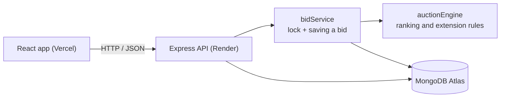
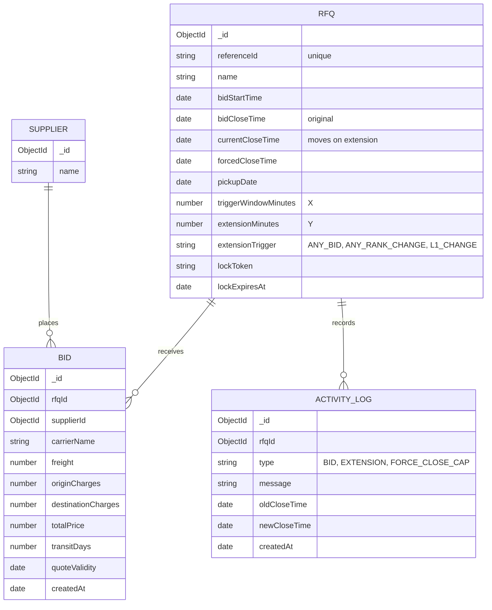

# Design notes

## What it does
A buyer creates an RFQ (request for quotes). Suppliers place bids on it. A bid made in
the last few minutes can push the closing time back, but never past the forced close time.

## Architecture

- Controllers check the input and call the service.
- `auctionEngine.js` holds the rules. It doesn't touch the database, so it's easy to test.
- `bidService.js` locks the RFQ, reads the current rankings, asks the engine whether to
  extend, and saves the bid, the new close time and a log entry.

## Schema

- Bids and logs are separate collections, because an RFQ can have many of each.
- `bidCloseTime` is the original deadline and `currentCloseTime` is the live one, so the
  first deadline is never lost.
- `totalPrice` is calculated on the server from the three charges.
- Indexes: bids on `(rfqId, supplierId, createdAt)` to find a supplier's latest bid, and on
  `(rfqId, totalPrice)` for ranking. `referenceId` is unique.

## Rules
- A supplier's current bid is their latest, and a new one must be lower.
- Rank 1 is the lowest total. If two are equal, the earlier bid wins.
- The window is the last X minutes before the close time.
- Triggers: any bid, any rank change, or a change of the lowest bidder.
- New close time = close time + Y, never later than the forced close time.
- Status (Active / Closed / Force Closed) is worked out from the times when it's read.

## Two bids at once
Two bids at the same moment could both read old data, and one extension would be lost.
Each RFQ has a lock that a bid takes while it is saved. The lock expires after 5 seconds,
so a crash can't block an auction forever.